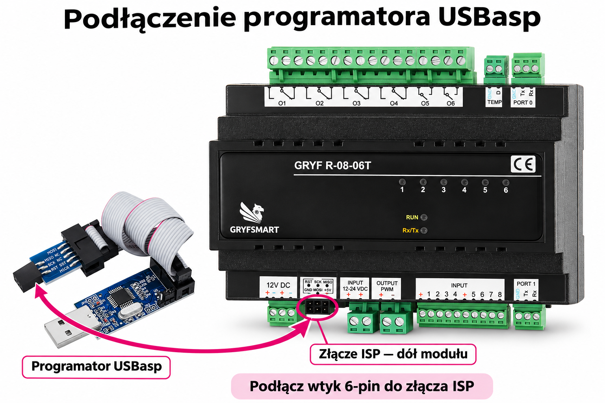

# 5. Instalator Bootloader

**[Pobierz najnowszą wersję 2.0.25](https://github.com/GRYF-SMART/gryfsmart-firmware/releases/download/v2026.11.13-s0804-compatible/GRYFSMART-Instalator.zip)**

Programator 2.0.25 i GRYFEXPERT 0.5.53 — zgodność z bootloaderem S0804 v12-chain1-led-on. Usunięto błędne odrzucanie aktualnego bootloadera S0804 z komunikatem wymagającym v11-chain1. Zapis przez RS-232 i aktualizacja CHAIN1 akceptują dla S0804 zarówno v11-chain1, jak i v12-chain1-led-on. Lista wersji dla innych modeli i kontrola modelu, MCU oraz protokołu… [Pełny opis wydania](https://github.com/GRYF-SMART/gryfsmart-firmware/releases/tag/v2026.11.13-s0804-compatible).

## Trzy ostatnie wersje

| Wersja | Data publikacji | Pobieranie | Zmiany |
|---|---|---|---|
| **2.0.25** | 2026-11-13 | [Pobierz](https://github.com/GRYF-SMART/gryfsmart-firmware/releases/download/v2026.11.13-s0804-compatible/GRYFSMART-Instalator.zip) | Programator 2.0.25 i GRYFEXPERT 0.5.53 — zgodność z bootloaderem S0804 v12-chain1-led-on. Usunięto błędne odrzucanie aktualnego bootloadera S0804 z komunikatem wymagającym v11-chain1. Zapis przez RS-232 i aktualizacja CHAIN1 akceptują dla S0804 zarówno v11-chain1, jak i v12-chain1-led-on. Lista wersji dla innych modeli i kontrola modelu, MCU oraz protokołu… [Pełny opis](https://github.com/GRYF-SMART/gryfsmart-firmware/releases/tag/v2026.11.13-s0804-compatible) |
| **2.0.24** | 2026-11-13 | [Pobierz](https://github.com/GRYF-SMART/gryfsmart-firmware/releases/download/v2026.11.13-installer-2.0.24/GRYFSMART-Instalator.zip) | Instalator 2.0.24 — wykrywanie i instalacja sterownika USBasp. Po podłączeniu USBasp (VID 16C0, PID 05DC) program sprawdza stan sterownika w Windows co 3 sekundy. Brak sterownika wyświetla czerwony komunikat oraz przycisk „Zainstaluj sterownik USBasp”. Brak urządzenia, kilka programatorów i błędy sprzętu Windows mają osobne komunikaty. Przycisk uruchamia… [Pełny opis](https://github.com/GRYF-SMART/gryfsmart-firmware/releases/tag/v2026.11.13-installer-2.0.24) |
| **2.0.23** | 2026-11-12 | [Pobierz](https://github.com/GRYF-SMART/gryfsmart-firmware/releases/download/v2026.11.12-installer-2.0.23/GRYFSMART-Instalator.zip) | Instalator 2.0.23 — automatyczna korekta fuse bitów wszystkich sześciu profili. Po kopii EEPROM instalator ustawia zewnętrzny kwarc Full Swing, wyłącza CKDIV8, wybiera obszar bootloadera i start od bootloadera oraz zachowuje ISP. ETH0606T/R0808/R0806T/S0804: 8 KiB; R0806T-OLD i ETH Mini GATE: 4 KiB zgodnie z ich procesorem i wsadem. Przed korektą czerwony… [Pełny opis](https://github.com/GRYF-SMART/gryfsmart-firmware/releases/tag/v2026.11.12-installer-2.0.23) |

## Pierwsza instalacja bootloadera — GRYFSMART-Instalator

**Bootloader wgrywa się tylko raz — przy pierwszym uruchomieniu modułu, który jeszcze go nie ma. Nowy moduł GRYFSMART ma już zainstalowany bootloader.**

Bootloader umożliwia późniejsze wgrywanie najnowszych wersji oprogramowania modułu przez **RS-232 lub Ethernet**, zależnie od modelu i dostępnego połączenia. Nie trzeba go ponownie instalować przy zwykłej aktualizacji oprogramowania. Ponowne wgranie jest potrzebne jedynie przy aktualizacji samego bootloadera.

**Po wgraniu bootloadera obie diody — RUN oraz RX/TX — świecą światłem ciągłym.** Jest to informacja, że bootloader został wgrany i moduł jest gotowy do wgrania aplikacji. Zaczekaj również na zakończenie weryfikacji w instalatorze.

Paczka ZIP z linku na górze zawiera instalator, AVRDUDE i wsady bootloaderów. Rozpakuj całą paczkę, zachowując strukturę katalogów. Sam plik EXE może nie zawierać potrzebnych plików towarzyszących.

### Podłączenie programatora — przykład R0806T

Strzałka wskazuje złącze ISP na dole modułu, pomiędzy zaciskami **12V DC** i **INPUT 12–24 VDC**. Podłącz tam wtyk 6-pin programatora, zgodnie z oznaczeniami sygnałów na module. Ilustracja pokazuje miejsce podłączenia w R0806T; położenie złącza w pozostałych modelach może być inne.

### Kolejność instalacji

1. Zapisz konfigurację instalacji. Zapewnij właściwe zasilanie płytki.
2. Podłącz **USBasp do złącza ISP/ICSP** wybranego modułu: MISO, MOSI, SCK, RESET, GND i właściwe napięcie odniesienia według dokumentacji płytki. RS-232 nie zastępuje ISP przy pierwszej instalacji.
3. Uruchom **GRYFSMART-Instalator.exe**, wybierz dokładny model modułu i sprawdź rozpoznany mikrokontroler.
4. Wybierz wgranie bootloadera. Operacja zmienia Flash i ustawienia startu mikrokontrolera; istniejąca aplikacja może zostać skasowana. Zaczekaj na odczyt, zapis i weryfikację.
5. Odłącz programator ISP i wgraj aplikację odpowiednią dla modelu [aktualizatorem GRYF](../AKTUALIZATOR).

| Model | Mikrokontroler | Zegar | Sekcja bootloadera |
|---|---|---|---|
| ETH0606T | ATmega2560 | 16 MHz | 8 KiB |
| R0808 | ATmega2560 | 18,432 MHz | 8 KiB |
| R0806T / S0804 | ATmega1284P | 18,432 MHz | 8 KiB |
| ETH Mini GATE | ATmega328P | 16 MHz | 4 KiB |

Dla Mini użyj ICSP J5 i zasilania płytki przez XS1; wyłącz zasilanie celu z USBasp i połącz masy. Inne płytki mają własny układ złączy — nie przenoś pinów Mini na inny model.

Kolejne aktualizacje aplikacji wykonuj przez istniejący bootloader. Nie trzeba ponownie instalować go przy każdym wydaniu firmware.

[1. Aplikacja GRYFSMART](https://github.com/GRYF-SMART/gryfsmart-firmware/tree/main/GRYFSMART) · [2. GRYFSMART-Programator](https://github.com/GRYF-SMART/gryfsmart-firmware/tree/main/AKTUALIZATOR) · [3. Driver Home Assistant](https://github.com/GRYF-SMART/gryfsmart-firmware/tree/main/HOME-ASSISTANT) · [4. Driver RTI](https://github.com/GRYF-SMART/gryfsmart-firmware/tree/main/RTI) · [5. Instalator Bootloader](https://github.com/GRYF-SMART/gryfsmart-firmware/tree/main/BOOTLOADER) · [6. Protokół GRYFSMART](https://github.com/GRYF-SMART/gryfsmart-firmware/tree/main/PROTOKOL) · [7. System i moduły GRYFSMART](https://github.com/GRYF-SMART/gryfsmart-firmware/tree/main/SYSTEM)
