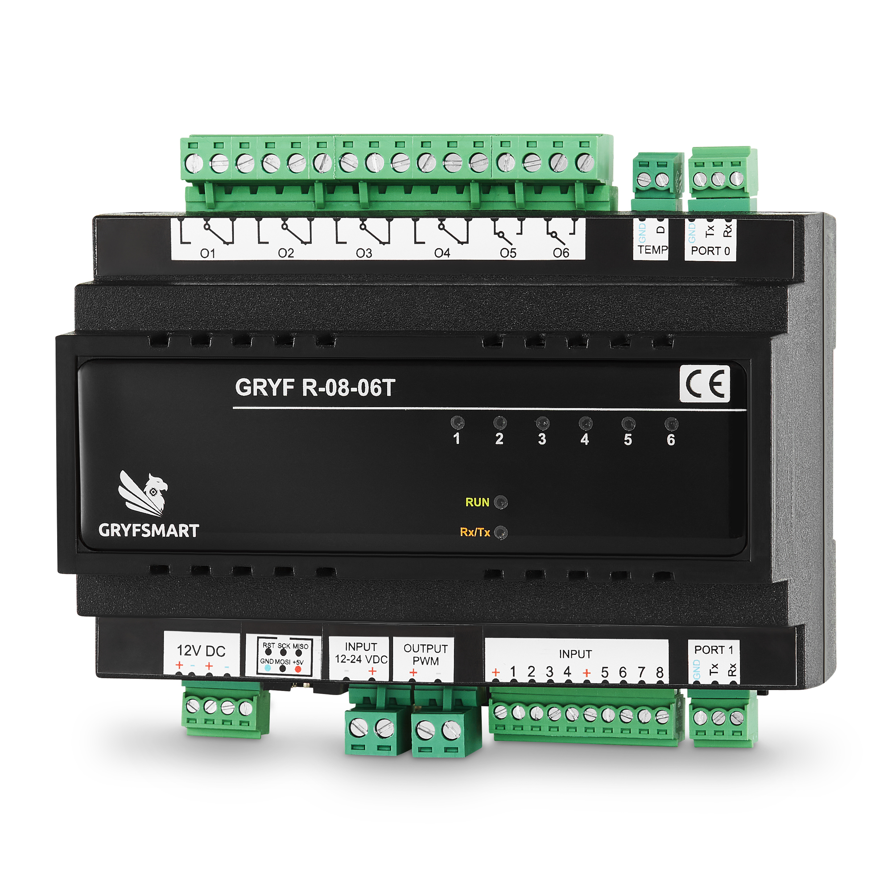

# R0806T — przekaźniki, PWM i temperatura

[← System i tabela modułów](README.md) · [Komendy R0806T](../docs/R0806T.md) · [Najnowsze oprogramowanie](../HEX)

R0806T to magistralny moduł automatyki systemu GRYFSMART. Może pracować autonomicznie lub w sieci modułów. Zależności przyczynowo-skutkowe konfiguruje się za pomocą aplikacji [GRYFEXPERT — pobieranie i instrukcja](../GRYFSMART).

Sterownik steruje sześcioma obwodami włącz/wyłącz oraz jasnością oświetlenia LED. Łączy obsługę przycisków i czujników ze sterowaniem przekaźnikami, PWM i pomiarem temperatury.

## Peryferia i złącza

| Peryferium | Opis |
|---|---|
| O1–O6 | 6 wyjść przekaźnikowych: 4 przełączne NO/NC i 2 NO; 16 A dla obciążenia rezystancyjnego (cos φ = 1) |
| INPUT 1–8 | Wejścia dla styków bezpotencjałowych; zwarcie, rozwarcie, krótkie naciśnięcie i przytrzymanie |
| OUTPUT PWM | Jeden kanał regulacji jasności LED; maksymalne łączne obciążenie **250 W** |
| INPUT 12–24 VDC | Zasilanie obwodu PWM, oddzielne od zasilania modułu |
| TEMP | DS18B20, zaciski GND i D; tryb pracy pasożytniczy |
| PORT 0 / PORT 1 | RS-232: GND, TX, RX; komunikacja z modułami i integracją |
| 12V DC | Zasilanie modułu 12 V DC ±1 V; maksymalny pobór prądu: 0,59 A |
| ISP | Złącze serwisowe programatora; [pierwsza instalacja bootloadera](../BOOTLOADER) |

Wyjście PWM nie jest dodatkowym przekaźnikiem. Wejście aktywuje się przez styk doprowadzający napięcie z odpowiedniego zacisku „+”, zgodnie z oznaczeniami zacisków.

## Funkcje oprogramowania

Bieżący protokół obejmuje sterowanie przekaźnikami, impuls i działania czasowe, sterowanie procentowe PWM z rampą, odczyt wejść, temperatury i flag wirtualnych. Szczegóły: [wyjścia](../docs/wyjscia-komendy.md), [czasy](../docs/wyjscia-czasowe.md), [reguły](../docs/reguly-R0806T.md).

## Zasilanie LED

Łączna moc odbiorników LED podłączonych do wyjścia PWM nie może przekraczać **250 W**. Moc zasilacza dobierz do mocy podłączonych LED, z zapasem **co najmniej 15%**: **P zasilacza ≥ 1,15 × P LED**. Dla 200 W LED potrzeba zasilacza o mocy co najmniej 230 W, a dla 250 W — co najmniej 287,5 W (np. 300 W). Napięcie zasilacza musi odpowiadać napięciu LED: 12 lub 24 V DC. Zapas mocy zasilacza nie zwiększa dopuszczalnego obciążenia wyjścia PWM.

## Sygnalizacja

Diody 1–6 wskazują stan poszczególnych wyjść.

| Wskaźnik | Znaczenie |
|---|---|
| RUN | Miga co 1 sekundę (1 Hz): moduł ma zasilanie i wykonuje program. |
| RX/TX | Zapala się na 0,2 sekundy po odebraniu ramki lub podczas wysyłania rozkazu danych. |
| RUN i RX/TX razem | Po wgraniu bootloadera obie diody świecą jednocześnie światłem ciągłym. |

## Montaż i warunki pracy

| Parametr | Wartość |
|---|---|
| Wymiary (szer. × wys. × gł.) | 138 × 118 × 70 mm |
| Temperatura pracy | +10°C do +35°C |
| Montaż | Szyna DIN35 |
| Stopień ochrony | IP20 |

[1. Aplikacja GRYFSMART](https://github.com/GRYF-SMART/gryfsmart-firmware/tree/main/GRYFSMART) · [2. GRYFSMART-Programator](https://github.com/GRYF-SMART/gryfsmart-firmware/tree/main/AKTUALIZATOR) · [3. Driver Home Assistant](https://github.com/GRYF-SMART/gryfsmart-firmware/tree/main/HOME-ASSISTANT) · [4. Driver RTI](https://github.com/GRYF-SMART/gryfsmart-firmware/tree/main/RTI) · [5. Instalator Bootloader](https://github.com/GRYF-SMART/gryfsmart-firmware/tree/main/BOOTLOADER) · [6. Protokół GRYFSMART](https://github.com/GRYF-SMART/gryfsmart-firmware/tree/main/PROTOKOL) · [7. System i moduły GRYFSMART](https://github.com/GRYF-SMART/gryfsmart-firmware/tree/main/SYSTEM)
