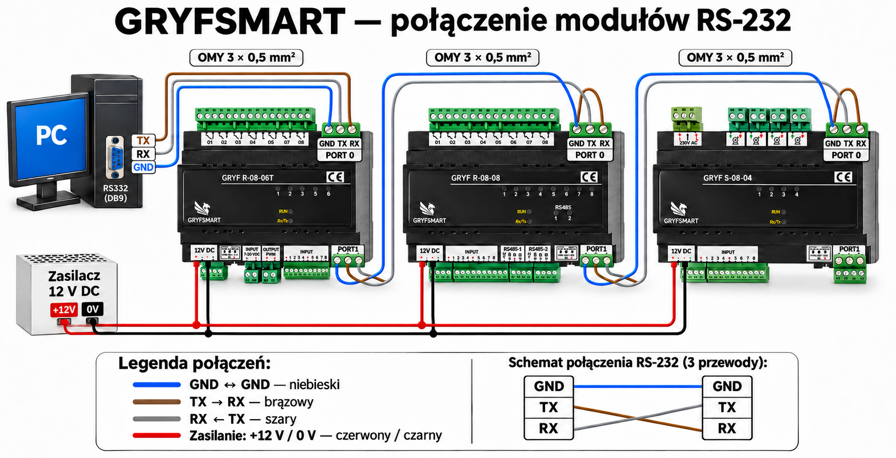

# System i moduły GRYFSMART

## System automatyki budynkowej

**GRYFSMART jest magistralnym systemem automatyki budynkowej. Każdy moduł ma własną logikę i może pracować autonomicznie.** System ma architekturę **multi-master**: każdy sterownik może inicjować komunikację i współpracować z innymi sterownikami w prawidłowo skonfigurowanej sieci.

Moduły realizują lokalnie zaprogramowane zależności między wejściami, wyjściami i zdarzeniami. Przykładowo przycisk może włączyć oświetlenie, uruchomić roletę albo wywołać działanie innego modułu. Konfigurację przygotowuje się w aplikacji **GRYFSMART / GRYFEXPERT**. Lokalne reguły nie wymagają stale uruchomionego komputera.

System pozwala sterować oświetleniem, obwodami włącz/wyłącz, zaworami i napędami osłon oraz odczytywać stany wejść i temperaturę — stosownie do wyposażenia wybranego modułu. Sterowniki przeznaczone są do montażu w rozdzielnicy na szynie DIN. [Produkty GRYFSMART](https://gryfsmart.pl/sterownik-gryf-r-08-06t/).

Do wizualizacji można podłączyć **komputer lub serwer Home Assistant** albo **procesor systemu RTI**. Pozwala to pokazać stan instalacji na panelach i telefonach oraz dodać złożone zależności, harmonogramy i współpracę z innymi urządzeniami. Automatyzacje uruchomione w HA lub RTI wymagają działania odpowiedniego systemu; logika zapisana w modułach pozostaje lokalna.

Komunikacja odbywa się przez **RS-232** lub przez **Ethernet TCP/IP z modułem bramki**, np. ETH0606T. Integrator korzysta z otwartego protokołu komend. [Protokół i przykłady](../PROTOKOL) · [Aplikacja konfiguracyjna](../GRYFSMART) · [Home Assistant](../HOME-ASSISTANT) · [RTI](../RTI).

## Wybierz moduł

Kliknij nazwę, aby zobaczyć zdjęcie, zastosowanie, opis peryferiów, złączy i funkcji.

| Moduł — szczegółowy opis | Zastosowanie | Wejścia | Wyjścia | Temperatura | Komunikacja |
|---|---|---|---|---|---|
| **[R0806T](R0806T.md)** | Oświetlenie, obwody ON/OFF i regulacja LED | 8 | 6 przekaźników + 1 PWM | 1 × DS18B20 | 2 × RS-232 |
| **[R0808](R0808.md)** | Osiem obwodów ON/OFF | 8 | 8 przekaźników | 1 × DS18B20 | 2 × RS-232; sprzętowo 2 × RS-485 |
| **[S0804](S0804.md)** | Rolety, żaluzje, markizy | 8 | 4 kanały napędów, każdy góra/dół | — | 2 × RS-232 |
| **[ETH0606T](ETH0606T.md)** | Sterowanie lokalne i bramka Ethernet | 6 | 6 przekaźników | Do 5 × DS18B20 | Ethernet, RS-232, USB; sprzętowo RS-485 |

Wszystkie cztery moduły wymagają zasilania elektroniki **12 V DC**. Zasilanie odbiorników, LED i napędów opisano na poszczególnych stronach. Funkcjonalność RS-485 zależy od wgranego oprogramowania; obecność złącza nie oznacza automatycznie obsługi dowolnego protokołu.

## Połączenie modułów RS-232

Ilustracja poglądowa; oznaczenia rzeczywistych zacisków sprawdzaj na obudowie. Połączenie tworzy linię:

**Komputer RS-232 → PORT 0 R0806T → PORT 1 → PORT 0 R0808 → PORT 1 → PORT 0 S0804.**

| Żyła kabla OMY 3 × 0,5 mm² | Strona pierwsza | Strona druga |
|---|---|---|
| Niebieska | GND | GND |
| Brązowa | TX | RX |
| Szara | RX | TX |

Każdy odcinek łączy **PORT 1 poprzedniego modułu z PORT 0 następnego**. TX i RX są skrzyżowane, masa GND wspólna. Komputer podłącza się do PORT 0 pierwszego modułu przez interfejs RS-232 lub adapter USB–RS232. Parametry: **115200 bit/s, 8N1, bez kontroli przepływu**. [Szczegóły komunikacji](../PROTOKOL#1-połączenie).

Osobną parą doprowadź **+12 V i 0 V do wejścia 12V DC każdego modułu**. Trzyżyłowy przewód komunikacji nie zastępuje zasilania. Zasilacz dobierz do sumy poboru wszystkich podłączonych urządzeń i spadków napięcia. Nie łącz TX/RX z +12 V ani z UART TTL.

## Ethernet, konfiguracja i uruchomienie

ETH0606T łączy sieć komputerową z modułami RS-232: **komputer / HA / RTI → Ethernet → ETH0606T → RS-232 → PORT 0 pierwszego modułu → kolejne moduły**. Wpisz rzeczywisty adres IP i port zgodny z konfiguracją bramki. [Opis ETH0606T](ETH0606T.md).

1. Podłącz zasilanie i komunikację zgodnie z oznaczeniami złączy.
2. Połącz aplikację GRYFEXPERT przez RS-232 lub Ethernet i zidentyfikuj moduły.
3. Nadaj unikalne ID, nazwy oraz skonfiguruj zdarzenia wejść i działania wyjść.
4. Zapisz konfigurację i sprawdź działanie lokalnych reguł.
5. Opcjonalnie uruchom integrację HA lub RTI, odczyt stanów i wizualizację.

Nowe moduły mają bootloader. Aktualizację aplikacji opisuje [GRYFSMART-Programator](../AKTUALIZATOR), a instalację lub aktualizację bootloadera przez ISP — [GRYFSMART-Instalator](../BOOTLOADER).

Dokumentacja sprzętu bazuje na materiałach producenta podlinkowanych na stronach modułów; funkcje bieżącego firmware opisano w [katalogu komend](../docs/README.md). W razie rozbieżności wersji sprzętu nie przenoś parametrów jednego wariantu na inny.

[1. Aplikacja GRYFSMART](https://github.com/GRYF-SMART/gryfsmart-firmware/tree/main/GRYFSMART) · [2. GRYFSMART-Programator](https://github.com/GRYF-SMART/gryfsmart-firmware/tree/main/AKTUALIZATOR) · [3. Driver Home Assistant](https://github.com/GRYF-SMART/gryfsmart-firmware/tree/main/HOME-ASSISTANT) · [4. Driver RTI](https://github.com/GRYF-SMART/gryfsmart-firmware/tree/main/RTI) · [5. Instalator Bootloader](https://github.com/GRYF-SMART/gryfsmart-firmware/tree/main/BOOTLOADER) · [6. Protokół GRYFSMART](https://github.com/GRYF-SMART/gryfsmart-firmware/tree/main/PROTOKOL) · [7. System i moduły GRYFSMART](https://github.com/GRYF-SMART/gryfsmart-firmware/tree/main/SYSTEM)
