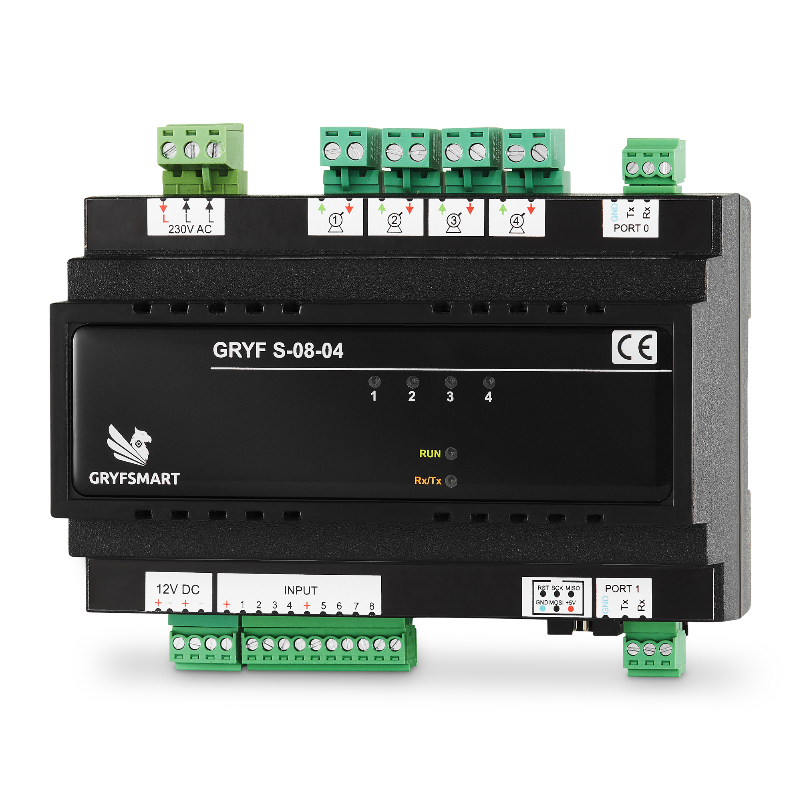

# S0804 — cztery napędy roletowe

[← System i tabela modułów](README.md) · [Komendy S0804](../docs/S0804.md) · [Najnowsze oprogramowanie](../HEX)

S0804 steruje czterema niezależnymi napędami rolet, żaluzji, markiz lub zasłon. Każdy kanał ma sterowanie kierunkami góra/dół i własne ustawienia pracy.

## Peryferia i złącza

| Peryferium | Opis |
|---|---|
| Kanały 1–4 | Cztery pary wyjść napędów 230 V AC: otwieranie i zamykanie |
| 230V AC / L | Zasilanie fazowe obwodów napędów; niezależne od 12 V elektroniki |
| INPUT 1–8 | 8 wejść dla przycisków i styków; zwarcie, rozwarcie, krótkie naciśnięcie, przytrzymanie |
| PORT 0 / PORT 1 | Dwa porty RS-232 z GND, TX i RX |
| 12V DC | Zasilanie elektroniki 12 V DC ±1 V; maksymalny pobór według strony: 0,49 A |
| ISP | Złącze serwisowe bootloadera |

Producent podaje obciążenie rezystancyjne 16 A oraz silnik roletowy 450 W. Są to różne rodzaje obciążenia. Przewody N i PE napędów prowadzi się do odpowiednich listew rozdzielnicy, według schematu instalacji.

## Pozycja, ruch i konfiguracja rolet

Aktualne oprogramowanie udostępnia otwieranie, zamykanie, STOP, kroki STEP oraz pozycję procentową: **0% = zamknięta, 100% = otwarta**. Pozycja jest szacowana na podstawie czasu przejazdu; nie jest pomiarem z czujnika położenia.

Najpierw ustaw osobno czasy pełnego otwierania i zamykania, następnie wykonaj kalibrację pełnym przejazdem. Odczyty pozwalają rozróżnić ruch, postój i pozycję. [Komendy, konfiguracja i raporty rolet](../docs/rolety-komendy.md) · [Reguły S0804](../docs/reguly-S0804.md).

## Sygnalizacja

Diody 1–4: zielony oznacza otwieranie, czerwony zamykanie, zgaszona — brak sterowania napędem. RUN wskazuje pracę programu, RX/TX komunikację. [Osobna sygnalizacja bootloadera](../BOOTLOADER).

Źródło sprzętowe: [strona S0804](https://gryfsmart.pl/sterownik-gryf-s-08-04/). Zdjęcie przekazane przez producenta; opis funkcji pochodzi z dokumentacji bieżącego firmware.

[1. Aplikacja GRYFSMART](https://github.com/GRYF-SMART/gryfsmart-firmware/tree/main/GRYFSMART) · [2. GRYFSMART-Programator](https://github.com/GRYF-SMART/gryfsmart-firmware/tree/main/AKTUALIZATOR) · [3. Driver Home Assistant](https://github.com/GRYF-SMART/gryfsmart-firmware/tree/main/HOME-ASSISTANT) · [4. Driver RTI](https://github.com/GRYF-SMART/gryfsmart-firmware/tree/main/RTI) · [5. Instalator Bootloader](https://github.com/GRYF-SMART/gryfsmart-firmware/tree/main/BOOTLOADER) · [6. Protokół GRYFSMART](https://github.com/GRYF-SMART/gryfsmart-firmware/tree/main/PROTOKOL) · [7. System i moduły GRYFSMART](https://github.com/GRYF-SMART/gryfsmart-firmware/tree/main/SYSTEM)
