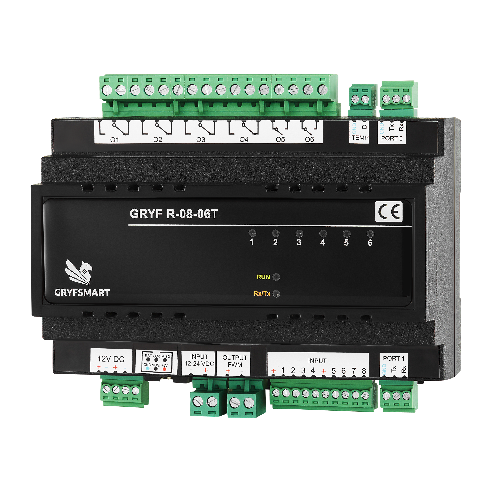

# R0806T — polecenia i przykłady

<p></p>

[Sieć, diagnostyka pętli i reset — komendy wspólne](komendy-wspolne.md#sieć-i-stan).

Osobny szczegółowy opis: [reguły RULE — konfiguracja, odczyty i przykłady](reguly-R0806T.md). [Ocena spójności wszystkich modułów](reguly-porownanie.md).

Obsługa przekaźników: [wspólny opis SetOut, GetOut i raportów stanu](wyjscia-komendy.md). R0806T używa o= i zakończenia CR; instrukcja porównuje ten wariant z R0808 i ETH.

Wspólny szczegółowy opis wejść: [I / PS / PL, KeyTime, GetInputs, GetKeyTime, zapis i Defaults](wejscia-komendy.md). Zawiera przykłady raportów oraz różnice między modułami.

**Wersja oprogramowania: 21.** ATmega1284P 18,432 MHz. Sześć przekaźników, wyjście PWM oraz dwa kanały termostatu i temperatury. Port logiczny 0 = USART0, port logiczny 1 = USART1.

## Informacje i wejścia

```text
AT<CR>
AT+Find<CR>
AT+Info=0<CR>
AT+Factory=0<CR>
AT+GetInputs=1<CR>
AT+KeyTime=1,1,5,20,27<CR>
AT+GetKeyTime=1,1,2<CR>
AT+SaveConfig=1,1<CR>
```

`AT` odpowiada `OK`; `AT+Find` zwraca ID, wersję oprogramowania i nazwę modelu. `AT+Info=0` zwraca identyfikację, MCU, wersję PCB/build i pola fabryczne; `AT+Factory=0` zwraca pola fabryczne. `AT+GetInputs=ID` odczytuje wejścia. `AT+KeyTime=ID,WEJŚCIE,KRÓTKI,DŁUGI,SUMA` ustawia progi w 0,1 s, krótkie musi być mniejsze od długiego, a długie nie może przekroczyć 250. `AT+GetKeyTime=ID,WEJŚCIE,SUMA` je odczytuje. `AT+SaveConfig=ID,ID` utrwala konfigurację.

## Przekaźniki i reguły

```text
AT+SetOut=1,1,0,0,0,0,0<CR>
AT+SetOut=1,0,3,0,0,0,0<CR>
AT+Rule=1,1,1,1,0,0,0,0,0,0,0,1,0,0,0,0,0,5<CR>
AT+GetRule=1,1,2<CR>
AT+SaveConfig=1,1<CR>
```

`AT+SetOut=ID,O1,...,O6` nie ma sumy kontrolnej. Akcje: 0 bez zmian, 1 włącz, 2 wyłącz, 3 przełącz. Przykłady włączają przekaźnik 1, następnie przełączają przekaźnik 2. `AT+Rule` ustawia jedną z 16 reguł: `ID,NR,EN,8 masek wejść,6 akcji wyjść,SUMA`. Maska wejścia: 1 krótkie, 2 długie, 4 zwarcie, 8 rozwarcie; można sumować wartości. Ostatni przykład włącza przekaźnik 1 przy krótkim naciśnięciu wejścia 1. `AT+GetRule=ID,NR,SUMA` odczytuje regułę. Po zapisie oczekuj `SaveOK=ID`.

## PWM — sterowanie bezpośrednie i rampa

```text
AT+PWM=1,4,50,55<CR>
AT+PWM=1,2,0,3<CR>
AT+PWM=1,1,0,2<CR>
AT+PWM=1,4,80,5,90<CR>
AT+GetPWM=1<CR>
```

Format `AT+PWM=ID,AKCJA,WARTOŚĆ[,RAMPA],SUMA`. Akcje: 0 bez zmian, 1 ON (ostatni niezerowy poziom), 2 OFF, 3 TOGGLE, 4 ustaw poziom 0–100%. Opcjonalna rampa to czas w 0,1 s (0–50, czyli do 5 s). Suma obejmuje wszystkie wcześniejsze liczby, łącznie z rampą. Przykłady: ustaw 50%, wyłącz, włącz ponownie na zapamiętane 50%, ustaw 80% z rampą 0,5 s. `AT+GetPWM=ID` zwraca `PWM=ID,POZIOM,DOCELOWY,ZAPAMIĘTANY,RAMPA_AKTYWNA,CZĘSTOTLIWOŚĆ_HZ`. Po zakończeniu zmiany moduł wysyła raport `PWM=...`; błąd może dać `PWMERROR=ID,...`.

PWM w regule:

```text
AT+RulePWM=1,4,4,50,5,64<CR>
AT+GetRulePWM=1,4,5<CR>
AT+Rule=1,4,1,0,1,0,0,0,0,0,0,0,0,0,0,0,0,7<CR>
AT+SaveConfig=1,1<CR>
```

`RulePWM=ID,NR,AKCJA,WARTOŚĆ[,RAMPA],SUMA` konfiguruje akcję PWM reguły. Po zmianie reguła zostaje wyłączona; `AT+Rule` ponownie ją włącza (w przykładzie wejście 2, krótki sygnał). `AT+GetRulePWM` odczytuje akcję. Najpierw sprawdź `AT+GetRule`/`AT+GetRulePWM`, aby zachować pozostałe pola.

## Termostat i temperatury

Są dwa kanały termostatu (`KANAŁ=1` lub `2`), a próbki mogą pochodzić z lokalnego ID=0 albo z innego modułu z czujnikiem. Temperatura i nastawa są w dziesiątych °C: 220 = 22,0°C. Format konfiguracji:

```text
AT+SetTemp=ID,KANAŁ,TRYB,CHŁODZENIE,ŹRÓDŁO_ID,CZUJNIK,NASTAWA,HISTEREZA,LICZBA_WYJŚĆ,[ID,RODZAJ,NUMER]...,SUMA<CR>
AT+GetTemp=ID,KANAŁ,SUMA<CR>
AT+GetTempCfg=ID,KANAŁ,SUMA<CR>
```

`TRYB=0` wyłącza, `1` włącza sterowanie; `CHŁODZENIE=0` oznacza grzanie, `1` chłodzenie. Histereza jest w 0,1°C. Dozwolone są do czterech wyjść: rodzaj 2 = lokalny/zdalny R0806T (1–6), rodzaj 3 = R0808 (1–8); ID wyjścia 0 oznacza własny moduł. Przykład: kanał 1 w trybie grzania, lokalny czujnik 1, nastawa 22,0°C, histereza 0,5°C, lokalny przekaźnik 1:

```text
AT+SetTemp=1,1,1,0,0,1,220,5,1,0,2,1,233<CR>
AT+GetTempCfg=1,1,2<CR>
AT+GetTemp=1,1,2<CR>
```

`GetTempCfg` zwraca `TEMP=` z konfiguracją. `GetTemp` zwraca `THERM=` z trybem, ważnością próbki, pomiarem, nastawą, histerezą i stanem. Brak świeżej próbki wstrzymuje zmianę wyjść. Dane `T=ID,CZUJNIK,WARTOŚĆ` otrzymywane z sieci są używane jako pomiary czujnika.

## Odczyt wejść i progów przycisków

GetInputs i GetKeyTime działają na obu UART-ach. Odczyty nie zmieniają konfiguracji, wyjść ani EEPROM, nie wykonują reguł ani nie usuwają oczekujących zdarzeń.
### GetInputs

```text
TX: AT+GetInputs=1<CR>
RX: I=1,1,0,0,0,0,0,0,1<CR><LF>
```

Format zapytania: `AT+GetInputs=ID`. ID: 1–35; ID=0 nie jest obsługiwane. Nie dodaje się sumy kontrolnej. Odpowiedź: `I=ID,WE1,WE2,WE3,WE4,WE5,WE6,WE7,WE8`. Stan 1 oznacza potwierdzone zwarcie do masy, 0 — rozwarcie. Przykład pokazuje zwarte wejścia 1 i 8. Jest to jeden spójny odczyt maski po filtracji drgań styków, a nie surowy odczyt pinów.

Komenda nie generuje naciśnięcia, nie wykonuje reguł i nie usuwa oczekujących zdarzeń wejściowych. Nie zmienia wyjść ani EEPROM. Automatyczne raporty zmiany wejść mają ten sam prefiks I= i mogą pojawiać się niezależnie od zapytania.

### GetKeyTime

```text
TX: AT+GetKeyTime=1,1,2<CR>
RX: KeyTime=1,1,5,20,27<CR><LF>
```

Zapytanie: `AT+GetKeyTime=ID,WEJSCIE,SUMA`, gdzie WEJSCIE=1–8, SUMA=ID+WEJSCIE. Odpowiedź: `KeyTime=ID,WEJSCIE,SHORT,LONG,SUMA`; suma odpowiedzi obejmuje cztery poprzednie liczby. W przykładzie 1+1+5+20=27, SHORT=0,5 s, LONG=2 s. Jednostka to 0,1 s, dozwolone progi: `1 <= SHORT < LONG <= 250`.

Odczytywana jest aktualna konfiguracja RAM, również zmieniona i jeszcze niezapisana. Sam odczyt nie dowodzi utrwalenia jej w EEPROM. Ustawianie i zapis:

```text
TX: AT+KeyTime=1,1,5,20,27<CR>
RX: RuleOK=1<CR><LF>
TX: AT+GetKeyTime=1,1,2<CR>
RX: KeyTime=1,1,5,20,27<CR><LF>
TX: AT+SaveConfig=1,1<CR>
RX: SaveOK=1<CR><LF>
```

GetKeyTime nie zmienia progów ani pomiaru aktualnie trzymanego przycisku. Błędny format, ID, numer wejścia lub suma powodują `RuleERROR=ID_MODULU`. Poprawne odczyty zwracają dane bez dodatkowego RuleOK. Moduły pośrednie muszą obsługiwać te zapytania i przekazywanie odpowiedzi KeyTime.

## Zdalny PWM przez RuleRemote

W oprogramowaniu w wersji **21** reguła R0806T obsługuje zdalny PWM jako typ 4, tak samo jak R0808, ETH0606T i S0804. Lokalny RulePWM/GetRulePWM pozostaje dostępny i może działać razem z akcją zdalną.

### Konfiguracja i odczyt

```text
AT+RuleRemote=ID,NR,SLOT,CEL,4,AKCJA,PROCENT,RAMPA,SUMA<CR>
AT+GetRuleRemote=ID,NR,SLOT,SUMA<CR>
RuleRemote=ID,NR,SLOT,CEL,4,AKCJA,PROCENT,RAMPA,SUMA<CR><LF>
```

ID: moduł przechowujący regułę (1–35); NR: reguła 1–16; SLOT: 1–4; CEL: inny moduł 1–35, posiadający PWM. Ten sam CEL nie może być powtórzony w kilku slotach danej reguły, zgodnie z dotychczasowymi zasadami R0806T oraz R0808/ETH.

| AKCJA | Działanie |
|---|---|
| 0 | Bez akcji; nie nadaje ramki PWM |
| 1 | Włącz ostatni niezerowy poziom odbiorcy |
| 2 | Wyłącz |
| 3 | Przełącz |
| 4 | Ustaw PROCENT |

PROCENT: 0–100, niezerowy wyłącznie dla akcji 4. RAMPA: 0–50 w jednostkach 0,1 s; 0 oznacza zmianę natychmiastową. SUMA jest sumą wszystkich wcześniejszych liczb.

Przykład: moduł 1 ma ustawiać PWM modułu 2 na 50%, z rampą 1 s:

```text
TX: AT+RuleRemote=1,1,1,2,4,4,50,10,73<CR>
RX: RuleOK=1
TX: AT+GetRuleRemote=1,1,1,3<CR>
RX: RuleRemote=1,1,1,2,4,4,50,10,73<CR><LF>
```

Następnie trzeba włączyć regułę pełną komendą Rule (zmiana slotu ustawia EN=0). Przykład wyzwalania krótkim naciśnięciem wejścia 1, bez lokalnych akcji przekaźników:

```text
TX: AT+Rule=1,1,1,1,0,0,0,0,0,0,0,0,0,0,0,0,0,4<CR>
RX: RuleOK=1
TX: AT+SaveConfig=1,1<CR>
RX: SaveOK=1
```

Po zdarzeniu wejścia R0806T nada na oba porty linii:

```text
AT+PWM=2,4,50,10,66<CR><LF>
```

Odbiorca wykonuje komendę bez uruchamiania własnej reguły. Wynik można sprawdzić przez AT+GetPWM=2. Slot typu 4 nie modyfikuje lokalnego PWM modułu 1. Suma przykładu wynosi 73.

### Trwałość i kolejki

Slot PWM w EEPROM ma trzy znaczące bajty danych (akcja, procent, rampa) i pięć zerowych bajtów rezerwowych. Układ pól i rozmiar reguły są zachowane; zapis utrwala SaveConfig.

Lokalne akcje nadal działają niezależnie od UART. Zdalna akcja czeka na wolne miejsce, zachowując kursor wykonania; nie jest wielokrotnie nadawana w wyniku ponawiania sprawdzenia kolejki. Nie dodano potwierdzania wykonania całej sceny.


