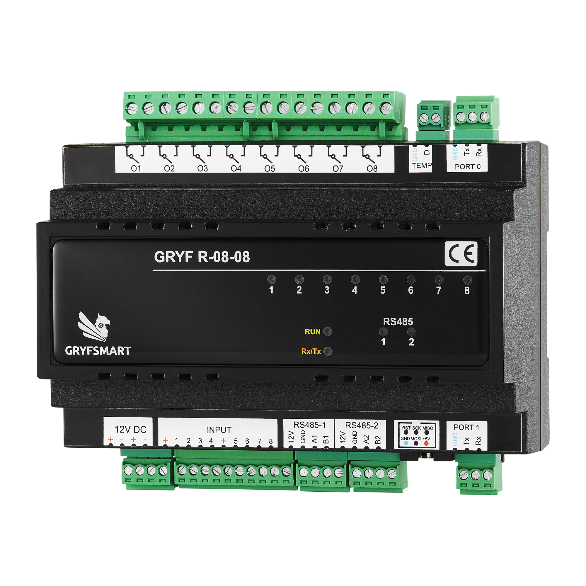

# R0808 — polecenia i przykłady

<p></p>

[Sieć, diagnostyka pętli i reset — komendy wspólne](komendy-wspolne.md#sieć-i-stan).

Osobny szczegółowy opis: [reguły RULE — konfiguracja, odczyty i przykłady](reguly-R0808.md). [Ocena spójności wszystkich modułów](reguly-porownanie.md).

Wspólny szczegółowy opis wejść: [I / PS / PL, KeyTime, GetInputs, GetKeyTime, zapis i Defaults](wejscia-komendy.md). Zawiera przykłady raportów oraz różnice między modułami.

**Wersja oprogramowania: 25.** ATmega2560 18,432 MHz. Moduł ma 8 wyjść przekaźnikowych. W nomenklaturze urządzenia port logiczny **0** to USART3, port logiczny **1** to USART1. Nie utożsamiaj numeru logicznego z numerem USART.

## Identyfikacja i diagnostyka

```text
AT<CR>
AT+Find<CR>
AT+Info=0<CR>
AT+Factory=0<CR>
```

`AT` odpowiada `OK`. `AT+Find` zwraca `AT+Find=ID,WERSJA,MODELE`. `AT+Info=0` pokazuje ID, wersję oprogramowania, model, MCU, rewizję PCB, informacje kompilacji oraz pola fabryczne; `AT+Factory=0` zwraca ID/wersję i pola fabryczne.

## Odczyt wejść, czasy przycisków i zapis

```text
AT+GetInputs=1<CR>
AT+KeyTime=1,1,5,20,27<CR>
AT+GetKeyTime=1,1,2<CR>
AT+SaveConfig=1,1<CR>
```

`AT+GetInputs=ID` odczytuje maskę stabilnych wejść. `AT+KeyTime=ID,WEJŚCIE,KRÓTKI,DŁUGI,SUMA` ustawia progi przycisku; czasy podawane są w dziesiątych częściach sekundy, krótkie musi być mniejsze od długiego, a długie nie może przekroczyć 250. `AT+GetKeyTime=ID,WEJŚCIE,SUMA` odczytuje parametry. Przykład ustawia wejście 1: krótki próg 0,5 s i długi 2 s. `AT+SaveConfig=ID,ID` zapisuje konfigurację do EEPROM. Odpowiedzi: `RuleOK=ID`, `KeyTime=...` albo `SaveOK=ID`/`SaveERROR=ID`.

## Ręczne sterowanie ośmioma przekaźnikami

```text
AT+SetOut=1,1,0,0,0,0,0,0,0<CR>
AT+SetOut=1,0,3,0,0,0,0,0,0<CR>
AT+SetOut=1,2,2,0,0,0,0,0,0<CR>
```

Format `AT+SetOut=ID,O1,...,O8`. Akcja `0` pozostawia wyjście bez zmian, `1` włącza, `2` wyłącza, `3` przełącza. Pierwszy przykład włącza wyjście 1, drugi przełącza wyjście 2, trzeci wyłącza wyjścia 1 i 2. Suma kontrolna nie występuje. Poprawna komenda zwraca `RuleOK=ID`; zmiany wyjść są też raportowane jako `O=ID,...`.

## Reguły wejść i wyjść

Jest 16 reguł. Format dla lokalnych ośmiu przekaźników:

```text
AT+Rule=ID,NR,EN,E1,E2,E3,E4,E5,E6,E7,E8,O1,O2,O3,O4,O5,O6,O7,O8,SUMA<CR>
AT+GetRule=ID,NR,SUMA<CR>
```

`NR` to reguła 1–16, `EN` to 0/1. Każda maska wejścia może łączyć zdarzenia: 1 krótkie naciśnięcie, 2 długie, 4 zwarcie, 8 rozwarcie; np. 12 oznacza zwarcie lub rozwarcie. Zdarzenia z wejść są łączone logicznym LUB. Akcje wyjścia jak w `AT+SetOut` (0 bez zmian, 1 włącz, 2 wyłącz, 3 przełącz). Poniższy przykład włącza przekaźnik 1 po krótkim naciśnięciu wejścia 1:

```text
AT+Rule=1,1,1,1,0,0,0,0,0,0,0,1,0,0,0,0,0,0,0,5<CR>
AT+GetRule=1,1,2<CR>
AT+SaveConfig=1,1<CR>
```

Każda zmiana reguły kasuje/zmienia tylko wskazane pola lokalnej części. Odczyt `Rule=` zwraca konfigurację i końcową sumę kontrolną. Reguły zdalne są konfigurowane poleceniem `AT+RuleRemote` i używają slotów docelowych. Dla ich konfiguracji sprawdź ID, typ modułu i obsługiwany format w instrukcji danego odbiornika.

## Temperatura — dwa kanały

R0808 może odczytać dwa lokalne czujniki DS18B20. `AT+TempScan=ID,ID` ponownie wyszukuje czujniki na module. Odczyt `AT+ReadTemp=ID,KANAŁ,ID+KANAŁ` zwraca ostatnią ważną próbkę jako `T=ID,KANAŁ,WARTOŚĆ` (wartość w dziesiątych częściach °C; np. 215 = 21,5°C). Przykład dla modułu ID=1, czujnika 2:

```text
AT+TempScan=1,1<CR>
AT+ReadTemp=1,2,3<CR>
```

Brak świeżej próbki, brak czujnika albo niepoprawny kanał zwraca `RuleERROR=ID`. Przy zmianie temperatury sterownik może też rozsyłać raport `T=...` w magistrali.


## Dodatkowe porty R0808

Poza dwoma portami RS-232 głównej linii oprogramowanie obsługuje dwa porty RS-485: logiczny 2 = USART0, logiczny 3 = USART2. Polecenia obce są przekazywane w parach 0↔1 i 2↔3; nie jest to automatyczny most między RS-232 a RS-485. Odpowiedź lokalna wraca na port zapytania.

RS-485 wymaga właściwego konwertera oraz zgodnego sterowania DE/RE. Wariant mapowania DE jest ustawieniem kompilacji odpowiednim dla PCB. Prędkość UART jest stałą kompilacji, nie parametrem zmienianym komendą AT. Podstawowe parametry komunikacji opisano w komendach wspólnych.