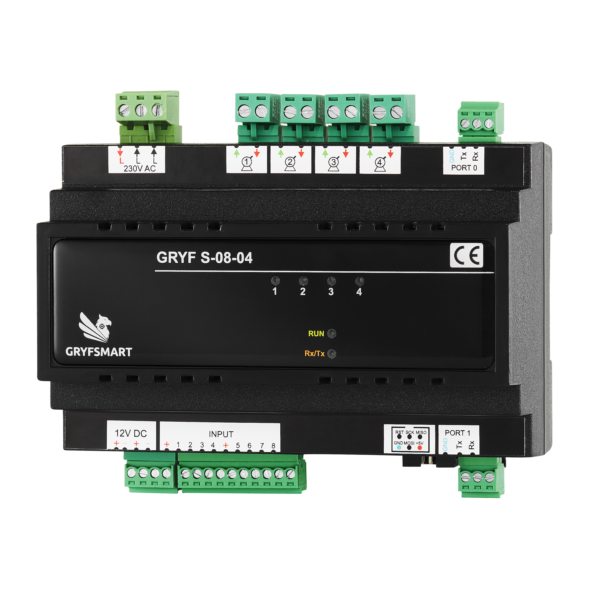

# S0804 — polecenia i przykłady

<p></p>

[Sieć, diagnostyka pętli i reset — komendy wspólne](komendy-wspolne.md#sieć-i-stan).

Osobny szczegółowy opis: [reguły RULE — konfiguracja, odczyty i przykłady](reguly-S0804.md). [Ocena spójności wszystkich modułów](reguly-porownanie.md).

Wspólny szczegółowy opis wejść: [I / PS / PL, KeyTime, GetInputs, GetKeyTime, zapis i Defaults](wejscia-komendy.md). Zawiera przykłady raportów oraz różnice między modułami.

**Wersja oprogramowania: 21.** ATmega1284P 18,432 MHz. Moduł steruje czterema roletami. Port logiczny 0 = USART0, port logiczny 1 = USART1.

## Identyfikacja, wejścia i rolety

```text
AT<CR>
AT+Find<CR>
AT+Info=0<CR>
AT+Factory=0<CR>
AT+GetInputs=2<CR>
AT+KeyTime=2,1,5,20,28<CR>
AT+GetKeyTime=2,1,3<CR>
AT+StanRol=2<CR>
```

`AT` zwraca `OK`; `AT+Find` zwraca ID/wersję oprogramowania/model. `Info` zwraca model, MCU, rewizję PCB, kompilację i dane fabryczne; `Factory` odczytuje dane fabryczne. `GetInputs` odczytuje stabilne wejścia. `KeyTime=ID,WEJŚCIE,KRÓTKI,DŁUGI,SUMA` ustawia progi w dziesiątych sekundy (długi > krótki, maks. 250); `GetKeyTime` je odczytuje. `StanRol=ID` odpowiada `R=ID,S1,S2,S3,S4`: 0 postój, 1 zamykanie, 2 otwieranie. Zmiana stanu ruchu może też generować raport.

Sterowanie roletą:

```text
AT+RolTime=2,1,120,115,238<CR>
AT+RolAct=2,1,1,0,4<CR>
AT+StanRol=2<CR>
AT+RolAct=2,1,3,0,6<CR>
AT+RolAct=2,1,7,50,60<CR>
AT+SaveConfig=2,2<CR>
```

`RolTime=ID,ROLETA,OTWARCIE,ZAMKNIĘCIE,SUMA` ustawia czasy przejazdu w 0,1 s (zakres 1–6000) i unieważnia kalibrację tej rolety. Po ustawieniu czasów wykonaj pełny przejazd OPEN/CLOSE, zanim użyjesz pozycji pośredniej. `RolAct=ID,ROLETA,AKCJA,PROCENT,SUMA`: 1 otwórz, 2 zamknij, 3 STOP, 4 STEP UP, 5 STEP DOWN, 6 STEP, 7 ustaw pozycję 0–100%. 0% to zamknięcie, 100% otwarcie; pozycja jest estymowana na podstawie czasu, bez czujnika położenia. Ruch może mieć 300 ms przerwy przy zmianie kierunku. `RuleOK` potwierdza przyjęcie, nie koniec ruchu.

## Reguły rolet

```text
AT+Rule=2,1,1,1,0,0,0,0,0,0,0,1,0,0,0,0,0,0,0,5<CR>
AT+GetRule=2,1,3<CR>
AT+GetRuleRemote=2,1,1,4<CR>
AT+SaveConfig=2,2<CR>
```

`AT+Rule=ID,NR,EN,E1..E8,A1,P1,A2,P2,A3,P3,A4,P4,SUMA` ustawia jedną z 16 reguł. EN=0/1. Maska wejścia: 1 krótkie, 2 długie, 4 zwarcie, 8 rozwarcie; można sumować, np. 12 = zwarcie lub rozwarcie. Rolety mają akcje 0 brak, 1 otwórz, 2 zamknij, 3 STOP, 4 STEP UP, 5 STEP DOWN, 6 STEP, 7 pozycja. Dla akcji 1–6 procent musi wynosić 0; dla akcji 7 procent to 0–100. `GetRule` odczytuje lokalną część; `GetRuleRemote` odczytuje miejsce zdalne 1–4.

Cel zdalny może sterować innym modułem; przykładowo wpis dla rolet ID=4 w slocie 1:

```text
AT+RuleRemote=2,1,1,4,1,1,0,1,0,1,0,1,0,13<CR>
AT+Rule=2,1,1,1,0,0,0,0,0,0,0,0,0,0,0,0,0,0,0,5<CR>
AT+SaveConfig=2,2<CR>
```

Po zmianie `RuleRemote` reguła jest wyłączona; końcowa komenda `Rule` włącza ją ponownie. Wszystkie moduły muszą mieć zgodne oprogramowanie do przekazywania komend, a sieć musi być liniowa. Sloty 1–4 mogą kierować do czterech osobnych ID. Dla odbiornika R0806T (typ 2) format zawiera sześć akcji przekaźników, a dla R0808 (typ 3) osiem akcji. Przykład pokazuje wyjścia 1 i 8 modułu R0808 ID=11 w slocie 2, uruchamiane krótkim naciśnięciem wejścia 1. Najpierw kasujemy slot 1, następnie konfigurujemy cel i aktywujemy regułę:

```text
AT+RuleRemote=2,1,1,0,0,4<CR>
AT+RuleRemote=2,1,2,11,3,1,0,0,0,0,0,0,1,21<CR>
AT+Rule=2,1,1,1,0,0,0,0,0,0,0,0,0,0,0,0,0,0,0,5<CR>
AT+SaveConfig=2,2<CR>
```

## Odczyt wejść i progów przycisków

GetInputs i GetKeyTime działają na obu UART-ach. Odczyty nie zmieniają konfiguracji, wyjść ani EEPROM, nie wykonują reguł ani nie usuwają oczekujących zdarzeń.
### GetInputs

```text
TX: AT+GetInputs=2<CR>
RX: I=2,1,0,0,0,0,0,0,1<CR><LF>
```

Zapytanie ma format `AT+GetInputs=ID`, bez sumy kontrolnej. ID: 1–35; 0 nie jest obsługiwane. Po ID odpowiedź zawiera stany WE1–WE8: 1 = zwarcie do masy, 0 = rozwarcie. Przykład pokazuje zwarte wejścia 1 i 8. Moduł odczytuje jedną maskę potwierdzonych stanów po filtrowaniu drgań, a nie surowy stan pinów.

Automatyczne raporty po zmianach wejść również zaczynają się od I=. Ich nadejście nie musi oznaczać odpowiedzi na zapytanie.

### GetKeyTime

```text
TX: AT+GetKeyTime=2,1,3<CR>
RX: KeyTime=2,1,5,20,28<CR><LF>
```

Zapytanie: `AT+GetKeyTime=ID,WEJSCIE,SUMA`; WEJSCIE=1–8, SUMA=ID+WEJSCIE. Odpowiedź: `KeyTime=ID,WEJSCIE,SHORT,LONG,SUMA`. Jednostka SHORT/LONG to 0,1 s; w przykładzie 0,5 s i 2 s. Suma odpowiedzi: 2+1+5+20=28. Zakres progów: `1 <= SHORT < LONG <= 250`.

Odczyt dotyczy aktualnego RAM. Progi ustawia się KeyTime, a utrwala przez SaveConfig:

```text
TX: AT+KeyTime=2,1,5,20,28<CR>
RX: RuleOK=2<CR><LF>
TX: AT+GetKeyTime=2,1,3<CR>
RX: KeyTime=2,1,5,20,28<CR><LF>
TX: AT+SaveConfig=2,2<CR>
RX: SaveOK=2<CR><LF>
```

Poprawne zapytanie do innego ID przechodzi drugim UART-em bez zmiany treści. Odpowiedzi I= i KeyTime= są przekazywane w przeciwną stronę. Błędny format/zakres/suma zwraca `RuleERROR=ID_MODULU`; poprawny odczyt nie wysyła dodatkowego RuleOK.

